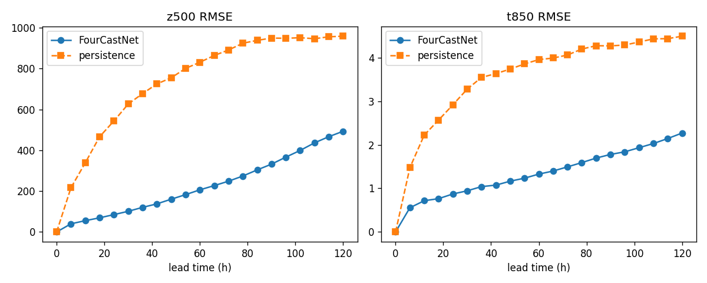

# FourCastNet: reproducible inference on PACE ICE

Runs [FourCastNet](https://github.com/NVlabs/FourCastNet) ([Pathak et al. 2022](https://arxiv.org/abs/2202.11214)) on PACE ICE (`coc-gpu`): original NVlabs code and paper weights, 5-day forecasts from ERA5 in 2018 (the paper's test year), scored against ERA5. The model predicts 20 variables 6 hours ahead on a 0.25° grid. `z500` is geopotential at 500 hPa, `t850` temperature at 850 hPa.

Model metadata: [`model.yaml`](model.yaml) · Recipe: [`recipes/fourcastnet-inference-era5.yaml`](../../../../recipes/fourcastnet-inference-era5.yaml) · Resource profile: [`resource-profiles/pace-ice/coc-gpu-a100.yaml`](../../../../resource-profiles/pace-ice/coc-gpu-a100.yaml) · Run evidence: [`evidence/`](evidence/)

## Setup

Needs a PACE ICE account with GPU access and about 25 GB free in `~/scratch`. Run from the repo root. Setup runs on the login node; prefetch runs on a CPU compute node.

```bash
git clone https://github.com/cyber-shuttle/cybershuttle-ai4science-foundry.git && cd cybershuttle-ai4science-foundry
sacctmgr -nP show assoc user=$USER format=Account,QOS   # edit scripts/fourcastnet_config.env if not coc / coc-ice
bash scripts/fourcastnet_setup_env.sh                   # ~10 min, ends with "AFNONet import ok"

srun -A coc -p coc-cpu -q coc-ice -c 4 --mem=16G -t 00:30:00 --pty bash
source scripts/fourcastnet_config.env && module load $MODULES
source "$(conda info --base)/etc/profile.d/conda.sh" && conda activate $CONDA_ENV_PREFIX
python scripts/fourcastnet_prefetch.py 2>&1 | tee $EVIDENCE_DIR/prefetch.log   # ~5 min, ends with "wrote .../2018.h5"
exit
```

Setup builds the env in `~/scratch/fourcastnet-work` and checks out NVlabs at commit `93360c1`. Prefetch downloads weights and ERA5, prints SHA-256 hashes, and checks each variable against the training mean (`t500` MISMATCH is expected, see below).

## Execution

```bash
source scripts/fourcastnet_config.env
sbatch --job-name=fcn-smoke scripts/fourcastnet_forecast.sbatch 2   # smoke test, 12 h
sbatch --job-name=fcn-full scripts/fourcastnet_forecast.sbatch      # 5-day forecast
sacct -j <jobid> --format=JobID,JobName,Partition,AllocTRES%60,Elapsed,MaxRSS,State,ExitCode > $EVIDENCE_DIR/sacct-<jobid>.txt
```

Each job (1× A100, 4 CPUs, 32 GB, 30 min) logs node, GPU, versions and commits, forecasts, then validates. Log: `evidence/<name>-<jobid>.out`. Results: `evidence/<jobid>/`.

Success: `evidence/<jobid>/validation.txt` shows only `PASS`, and `sacct` shows `COMPLETED 0:0`. A failed check ends the job as `FAILED`.

## Verification

`fourcastnet_validate.py` checks (all pass, [validation.txt](evidence/6185950/validation.txt)):

1. **Smoke:** shape, finite values, plausible ranges for `z500`, `t850`, `t2m`, `u10`.
2. **Error grows with lead time.**
3. **Beats persistence** (weather held at the start state) at every lead for `z500` and `t850`. A model with wrong weights or variable order fails this.

Latitude-weighted RMSE vs ERA5, mean of 2018-01-01 and 2018-07-01:

| Variable | Lead | FourCastNet | Persistence | ACC |
|---|---|---|---|---|
| `z500` (m²/s²) | 24 h / 48 h / 120 h | 85.0 / 160.6 / 493.2 | 543.6 / 755.0 / 958.5 | 0.997 / 0.991 / 0.916 |
| `t850` (K) | 24 h / 48 h / 120 h | 0.87 / 1.17 / 2.27 | 2.92 / 3.74 / 4.49 | 0.990 / 0.983 / 0.937 |

Paper (Pathak et al. 2022, Fig. 13; 36 start dates in 2018, 9 days apart): `z500` RMSE roughly 150–200 at 48 h and about 500 at 120 h; `t850` roughly 1.2–1.3 K at 48 h. Our values fall in the same range. Exact agreement isn't expected with 2 start dates instead of 36.



## Hardware and provenance

- **Hardware:** NVIDIA A100-PCIE-40GB on `coc-gpu`. Peak RAM was about 15 GB, and the full 5-day job took 38 s (`evidence/sacct-*.txt`). A rerun from a fresh clone on a different node gave identical results.
- **Code and weights:** NVlabs/FourCastNet at commit `93360c1`, unmodified; v0 weights from the NERSC portal. Commit, URLs and SHA-256 hashes are in [`model.yaml`](model.yaml).
- **Data:** ERA5 via WeatherBench2's public copy (6-hourly, 0.25°). Per-variable checks are in `evidence/prefetch.log`.
- **Software:** Python 3.11, PyTorch 2.4.1+cu121, numpy 1.26.4. Exact versions in `evidence/env/`.
- **Differences from the paper:** newer PyTorch, ERA5 from WeatherBench2 instead of the authors' files (their 2018 data is Globus-only), and 2 start dates instead of many.

## Troubleshooting

**Home quota.** PACE home is 30 GB. All large files go to `~/scratch/fourcastnet-work`. Keep the repo clone outside that folder.

**`ImportError: cannot import name 'cbuffer_sizes'`.** `numcodecs` 0.16 breaks `zarr` 2.18. Pinned `numcodecs==0.13.1`.

**`t500` MISMATCH.** NVlabs stats for `t500` are 0.8× real values (202.9 K vs about 253 K), likely one zero-filled year among the 5 in `get_stats.py`. The model was trained with these stats, so real `t500` is used.

**Prefetch prints nothing, or `OSError: bad object header version number`.** On the login node, prefetch was killed silently partway through, leaving a broken `2018.h5`. Run it on a compute node (as above); it recreates the file each run.

**Huge errors, identical for both dates.** Prefetch was interrupted, so the ERA5 file is zeros. Rerun it until it prints `wrote .../2018.h5`.

**Handled in the scripts:** the NVlabs config's `!bool` tag breaks strict YAML loaders (config is extended as text); `--vis` crashes with several start dates (one run per date); saved fields are normalized (validation converts back).

## Cleanup

```bash
rm -rf ~/scratch/fourcastnet-work   # env, NVlabs code, weights, ERA5, raw forecasts
```
